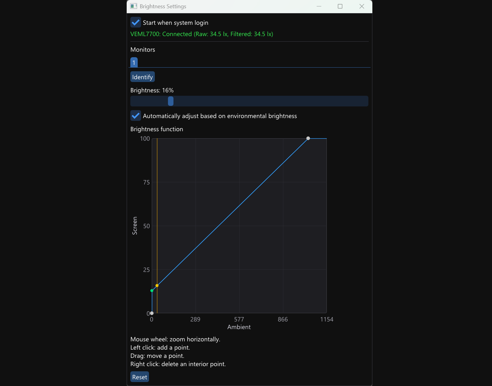

# Brightness settings
Automatically adjust monitors' brightness according to ambient light

## Install

Get PCB:

-   VEML 7700 (ambient light sensor)
-   MCP 2221 (USB to I2C bridge)

Use female to female DuPont and jumpers to connect the following pairs of pin.

| VEML 7700 | MCP 2221 |
| --------- | -------- |
| 3V        | VIN      |
| GND       | GND      |
| SCL       | SCL      |
| SDA       | SDA      |

Use any male to male USB cable, plugging MCP 2221 into the computer's USB portal.

Execute this program. It will stay in system tray. The user can set starting with operation system later in the settings.

## Tested monitors

| Specification | Result |
| ------------- | ------ |
| Dell P2423D   | Pass   |

## Hardware Liability

EEPROM Wear Notice.

This application controls display luminance over the Display Data Channel Command Interface (DDC/CI) using standard VESA Virtual Control Panel (VCP) code `0x10`. The software is provided "as is", without warranty of any kind; the author assumes no liability for hardware damage, scaler corruption, or non-volatile memory wear resulting from its use. 

Different monitor scalers handle DDC/CI write commands differently. Enterprise and modern consumer monitors (particularly those officially supported by first-party utilities such as Dell Display Manager, LG OnScreen Control, or EIZO Screen InStyle) stage brightness modifications directly in volatile MCU SRAM and only commit values to non-volatile flash upon graceful power-down or after extended idle periods. However, low-cost or older monitor scalers may commit every single DDC/CI write directly and synchronously to an onboard I2C EEPROM (typically rated for ~100,000 write cycles). 

To minimize unnecessary EEPROM write cycles, this program incorporates the following protections:
1. In automatic mode, target brightness adjustments smaller than 5% are discarded. Minor ambient light jitter and sensor noise do not dispatch brightness adjustment commands.
2. The sensor reads ambient light and current screen brightness every 5 seconds. Then, it adjusts screen brightness if the difference between current and target brightness exceed 5%, or do nothing if the difference is smaller.

>   [!TIP]
>
>   To check if your monitor caches brightness safely in volatile RAM, change the brightness via the application slider, then immediately pull the AC power plug from the wall without using the monitor's power button. If the display reboots to its previous brightness level instead of the modified value, your scaler uses deferred non-volatile caching and is fully safe against wear.

## Usage

